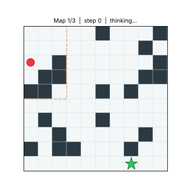
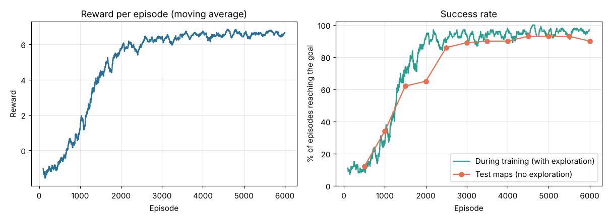

# 🤖 Robot That Learns From Its Environment (Deep Q-Network)

A robot is dropped into a random grid full of obstacles and has to reach a goal. Nobody tells it how. It learns by **trial and error**, using **deep reinforcement learning (a Deep Q-Network)**. The neural network, backpropagation and Adam optimizer are all written from scratch in **NumPy**. No PyTorch or TensorFlow is needed.



*The red robot navigates maps it has never seen. The dashed orange box is its sensor window, and the green star is the goal.*

## Results

After training for 6,000 episodes (about 4 minutes on a normal laptop CPU), tested on **500 brand-new maps**:

| | Trained robot | Random robot |
|---|---|---|
| Reaches the goal | **92.6%** | 6.4% |
| Path efficiency (1.0 = shortest possible) | **0.96** | n/a |
| Wall bumps per episode | **0.15** | 12.6 |

Exact numbers vary a little between training runs and seeds.



## How it works

**The robot's senses (network input, 52 numbers).** The robot cannot see the whole map:
- A 5x5 window around itself showing which cells are blocked (walls and obstacles).
- A short memory of how often it has visited each cell in that window, which helps it escape dead ends.
- The direction to the goal, like a compass.

**Actions (network output, 4 numbers).** Up, down, left, right. The network predicts how good each action is (the Q-value), and the robot picks the best one.

**Rewards (the only teacher):**

| Event | Reward |
|---|---|
| Reach the goal | +5 |
| Bump into a wall or obstacle | -0.3 |
| Every step | -0.02 |
| Move closer to or farther from the goal | small bonus or penalty (potential-based shaping) |

**Learning algorithm: Double DQN**
- **Experience replay:** past experiences are stored and sampled randomly for training.
- **Target network:** a slowly updated copy of the network keeps the learning targets stable.
- **Double Q-learning:** reduces over-estimation of Q-values.
- **Epsilon-greedy exploration:** starts fully random (100%) and slowly shifts to mostly using what it learned (5% random).
- **Network:** 52 → 128 → 128 → 4, ReLU, Huber loss, Adam, gradient clipping.

Every episode uses a **new random map**, so the robot must learn general navigation skills rather than memorize one layout.

## Quick start

Requires Python 3.9 or newer.

```bash
# 1. (optional) create a virtual environment
py -m venv .venv
.venv\Scripts\activate          # Windows
# source .venv/bin/activate       # macOS / Linux

# 2. install dependencies
pip install -r requirements.txt

# 3. watch the pre-trained robot (opens an animation window)
python demo.py
```

On Windows, use `py` instead of `python` if `python` doesn't work.

A trained model is already included in `models/robot_dqn.npz`, so the demo works straight away.

### All commands

| Command | What it does |
|---|---|
| `python demo.py` | Animated window of the robot solving new maps |
| `python demo.py --maps 6 --seed 10` | Choose how many maps and which ones |
| `python demo.py --save assets/demo.gif --no-show` | Save the animation as a GIF |
| `python train.py` | Train a new robot from scratch (about 4 min) and save the model and curve |
| `python train.py --episodes 1000 --out models/quick.npz` | Quick training run |
| `python evaluate.py` | Test the model on 500 unseen maps and compare with a random robot |
| `python -m unittest discover -s tests -v` | Run the unit tests |

## Project structure

```
robot-learns-dqn/
├── robot_rl/
│   ├── env.py          # the grid world, sensors and rewards
│   ├── nn.py           # neural network + backprop + Adam (NumPy)
│   ├── agent.py        # Double DQN agent and replay buffer
│   ├── evaluation.py   # success rate and path efficiency metrics
│   └── viz.py          # matplotlib drawing and animation
├── train.py            # train the robot
├── evaluate.py         # test the robot
├── demo.py             # watch the robot
├── tests/              # unit tests
├── models/             # trained model (robot_dqn.npz)
├── assets/             # demo.gif and training_curve.png
├── requirements.txt
└── LICENSE
```

## Experiment ideas

- Change `--density` (for example `0.25`) for harder maps, or `--size` for bigger grids.
- Change rewards at the top of `robot_rl/env.py` and see how behavior changes.
- Make the robot's sight larger (`view=7` in `GridRobotEnv`) or smaller (`view=3`).
- Add moving obstacles, a battery, or multiple goals to the environment.
- Swap `nn.py` for PyTorch if you want to try GPU training or convolutional layers.

## License

MIT. See [LICENSE](LICENSE).
